# Rulo en Torre Fuerte Ops · revisión

**Rama de revisión, sin publicar en producción.** Las seis ilustraciones están integradas en la app existente con WebP preferido y PNG de respaldo. Se conserva el diseño y las funciones del taller.

Estas capturas proceden del navegador y usan datos ficticios aislados, sin insertarlos en Supabase. Despliega cada escena para revisar móvil y escritorio; pulsa una imagen para verla a tamaño completo.

<strong>Acceso</strong>

Rulo acompaña al formulario; Entrar sigue visible en móvil.

**Móvil · 390 px**

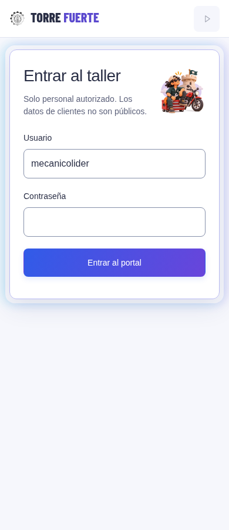

**Escritorio · 1440 px**

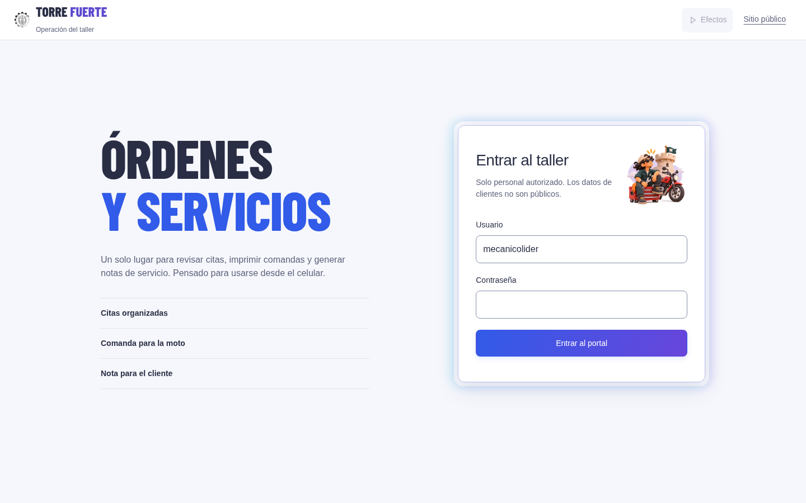

[Antes: móvil](qa/rulo/before/login-390.png) · [Antes: escritorio](qa/rulo/before/login-1440.png)

<strong>Taller sin órdenes</strong>

Solo aparece después de una consulta correcta sin registros.

**Móvil · 390 px**

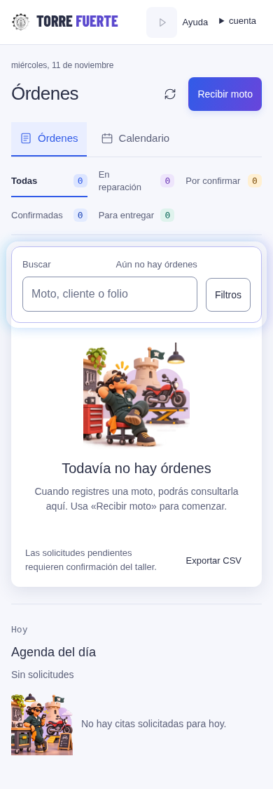

**Escritorio · 1440 px**

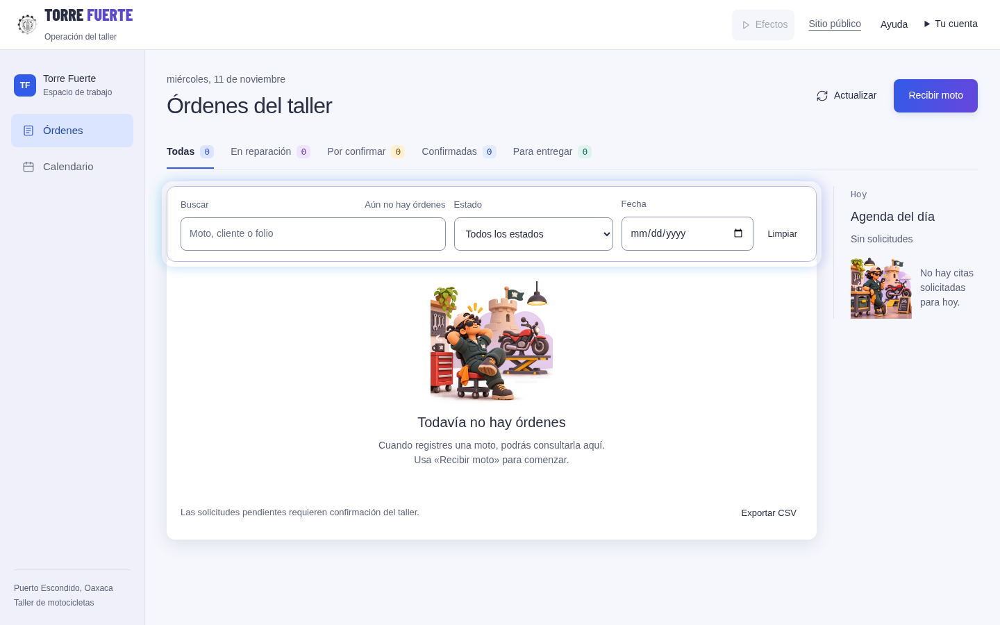

[Antes: móvil](qa/rulo/before/orders-empty-390.png) · [Antes: escritorio](qa/rulo/before/orders-empty-1440.png)

<strong>Sin solicitudes para hoy</strong>

Acompaña la agenda vacía; las órdenes existentes siguen visibles.

**Móvil · 390 px**

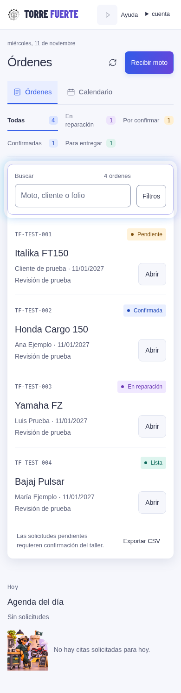

**Escritorio · 1440 px**

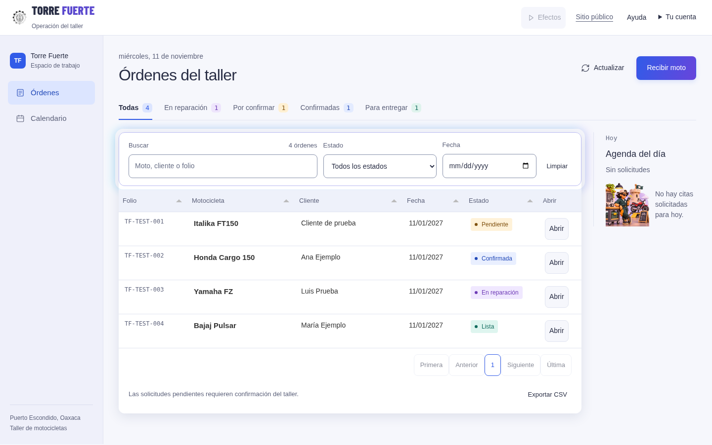

[Antes: móvil](qa/rulo/before/agenda-empty-390.png) · [Antes: escritorio](qa/rulo/before/agenda-empty-1440.png)

<strong>Búsqueda sin coincidencias</strong>

Usa la escena de carpeta/lupa sin inventar un módulo de historial.

**Móvil · 390 px**

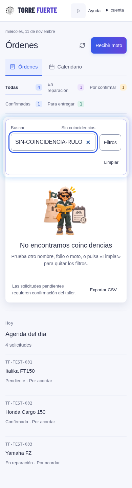

**Escritorio · 1440 px**

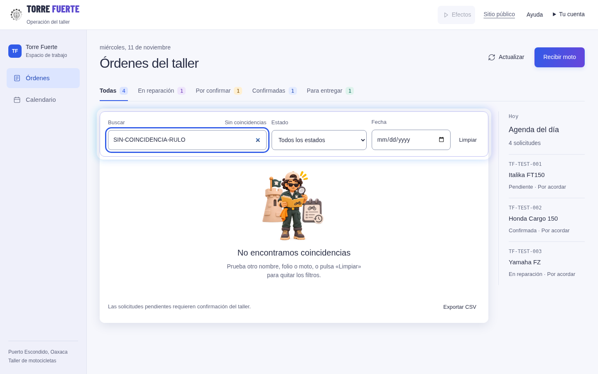

[Antes: móvil](qa/rulo/before/search-empty-390.png) · [Antes: escritorio](qa/rulo/before/search-empty-1440.png)

<strong>Servicio finalizado</strong>

Aparece al confirmar Lista/Entregada; la acción de nota permanece disponible.

**Móvil · 390 px**

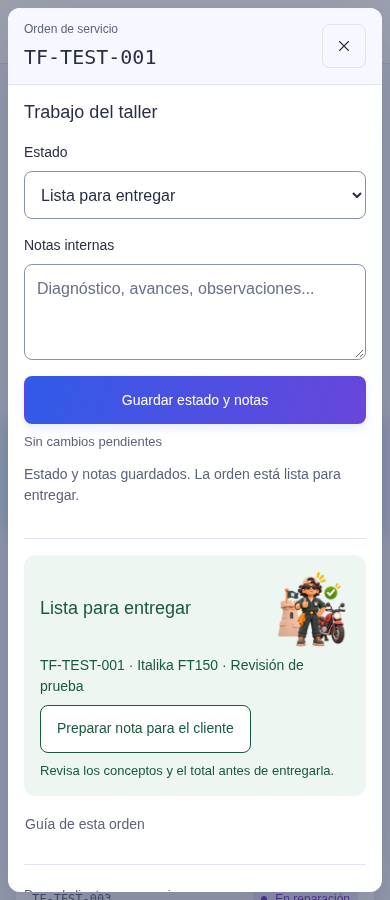

**Escritorio · 1440 px**

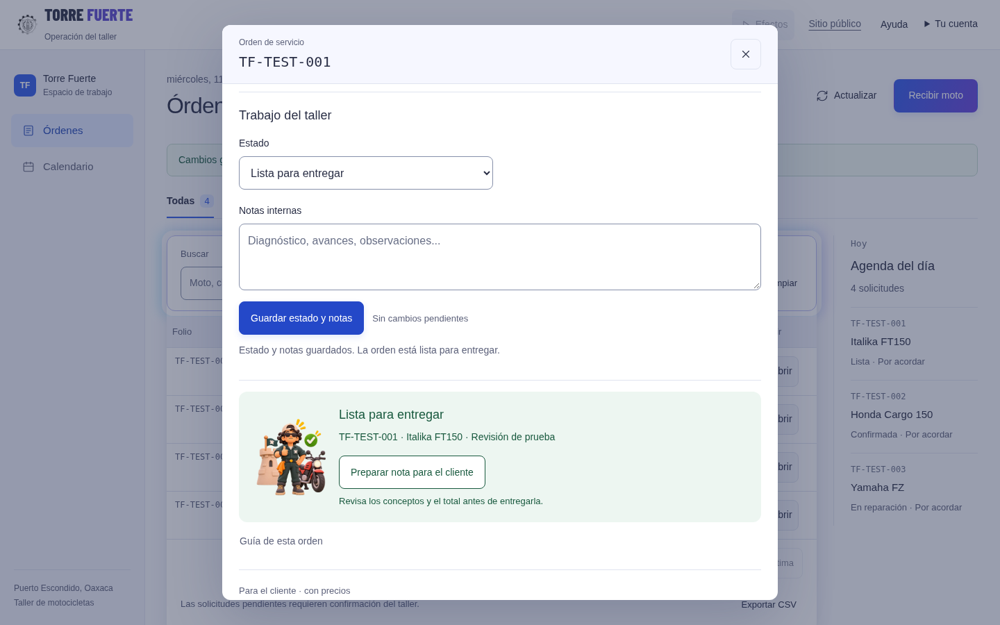

[Antes: móvil](qa/rulo/before/complete-390.png) · [Antes: escritorio](qa/rulo/before/complete-1440.png)

<strong>Sin conexión</strong>

Apoya el aviso escrito; la imagen está disponible al quedar offline.

**Móvil · 390 px**

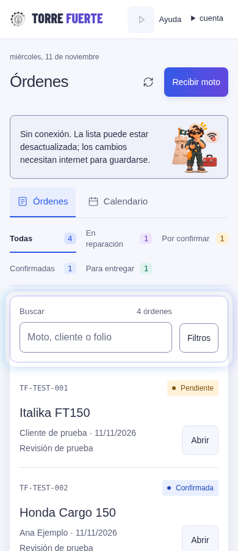

**Escritorio · 1440 px**

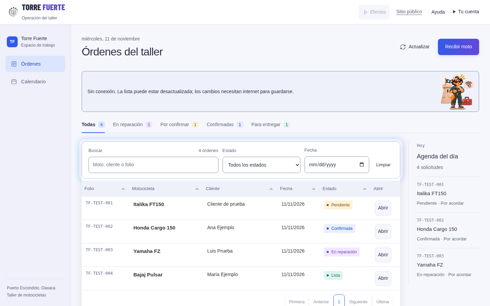

[Antes: móvil](qa/rulo/before/offline-390.png) · [Antes: escritorio](qa/rulo/before/offline-1440.png)

[Informe de integración y pruebas](rulo-integration.md) · [Resultados de estados, geometría y accesibilidad](qa/rulo/results.json).
